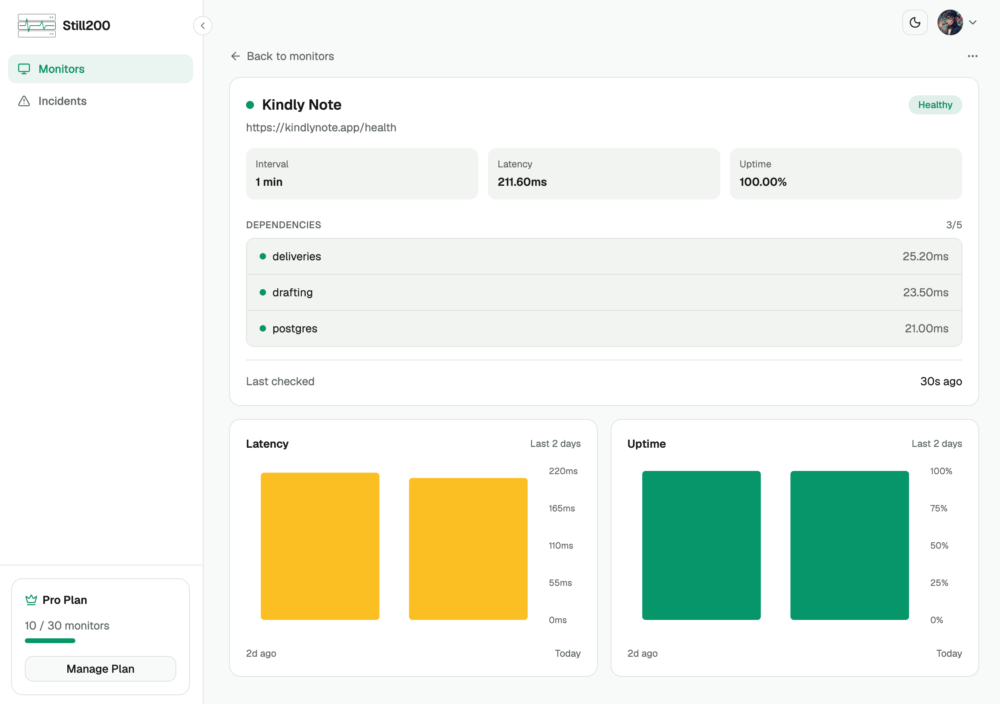

I recently built [Kindly Note](https://kindlynote.app), a fun
little app that uses AI to turn everyday messages into beautifully worded notices, which you can then send anonymously via email.

After getting it up and running, I figured it would make a good real-world example of how to set up monitoring with [Still200](https://still200.com), another product I've been building.

The idea is simple: I want to know when something breaks, preferably before someone using the app tells me.

## Quick look at the stack

Kindly Note is intentionally simple:
- **Python/FastAPI** for the backend
- **Jinja templates + HTMX** for the frontend
- **Postgres** for the database and notification delivery job queue
- **OpenAI API** for drafting the notices
- A background worker written in Python for processing notifications

Even with a relatively simple setup like this, quite a few things can go wrong.

The API might be responding perfectly fine, but the database could be unavailable. The OpenAI API could be failing, preventing users from generating notices. The background worker could also stop processing emails, leaving notices sitting in the queue indefinitely.

In all these cases, a simple check that the homepage returns HTTP 200 wouldn't tell me the full story.

## What I need to monitor

For this setup, I want to answer the following questions:
1. **Is the application up?** Can users reach the app and get a successful HTTP response?
2. **Is the database healthy?** Can the application connect to and query Postgres?
3. **Is notice generation working?** Can the application communicate with the OpenAI API?
4. **Is the email worker running?** Is it actively processing jobs, or has it silently stopped?

I'll walk through how I set up these checks using Still200, including the small changes I made to Kindly Note to expose the information needed for monitoring.

## Setting up HTTP monitoring

Let's start with the basics: making sure the application is up and responding
to requests.

Still200 supports HTTP monitoring, which periodically sends requests to a URL and checks whether the application responds successfully. If a check fails, Still200 records an incident and sends a notification.

For Kindly Note, I've exposed a simple health endpoint in the FastAPI application:

```python
@app.get("/health")
async def health():
    return {"service_name": "Kindly Note"}
```

This gives us a lightweight endpoint at https://kindlynote.app/health that returns an HTTP `200 OK` response when the application is running.

## Creating the monitor in Still200

With the endpoint ready, I can head over to the [Still200 dashboard](https://app.still200.com) and create a new HTTP monitor.
The setup is straightforward: add the URL, validate it, set the check interval. That's it.

<video autoplay muted loop playsinline
       style="width: 100%; border-radius: 10px;">
  <source src="/videos/still200-demo.mp4" type="video/mp4">
</video>

Still200 will now send a request to the health endpoint every minute and track whether the application is responding successfully.

If the endpoint becomes unreachable, times out, or returns an unsuccessful HTTP status code, Still200 can detect the failure and notify me.

Once the monitor is running, I can also see its uptime history, response times, and any incidents that have occurred.

This is a good starting point.
However, a `200` does not tell the whole story.
What if Postgres is unavailable? Or the email delivery worker stops running?
The application could still return HTTP `200` while some of its most important functionality is broken.

That's where dependency monitoring comes in.

In the next section, we'll extend this health endpoint to report the status of the application's dependencies, giving us a much better picture of what's actually working.

## Monitoring application dependencies

Now that we know Kindly Note is reachable, let's take things a little further.

An application being up doesn't necessarily mean everything is working. Kindly Note, for example, relies on Postgres to store notices and queue email deliveries, and the OpenAI API to generate notices.

If either of these dependencies fails, parts of the application stop working, even if the FastAPI server continues responding to requests.

Fortunately, Still200 supports monitoring individual dependencies through the same HTTP monitor we just created.

### Monitoring Postgres

For Postgres, we'll execute a lightweight `SELECT 1` query to verify that our application
can communicate with the database. Using FastAPI and SQLAlchemy, the check might look something like this:

```python
import asyncio
import logging
import time

from sqlalchemy import text
from sqlalchemy.ext.asyncio import AsyncSession

logger = logging.getLogger(__name__)


async def check_postgres(session: AsyncSession) -> dict:
    start = time.perf_counter()
    error = None

    try:
        async with asyncio.timeout(2):
            await session.execute(text("SELECT 1"))

    except TimeoutError:
        error = "Database check timed out"
        logger.warning("Postgres health check timed out")

    except Exception:
        error = "Database connection failed"
        logger.exception("Postgres health check failed")

    latency_ms = round(
        (time.perf_counter() - start) * 1000, 2
    )

    result = {"latency_ms": latency_ms}

    if error:
        result["error"] = error

    return {"postgres": result}
```

**What this gives us:**

A successful check:

```json
{
  "postgres": {
    "latency_ms": 22.14
  }
}
```

A timeout:

```json
{
  "postgres": {
    "latency_ms": 2001.27,
    "error": "Database check timed out"
  }
}
```

A couple of things worth pointing out here.

First, we're using `asyncio.timeout()` (Python 3.11+) to limit the database check to two seconds. If Postgres becomes unresponsive, we don't want our health endpoint waiting indefinitely.

Second, we're measuring elapsed time even when the check fails. This gives us a useful latency measurement regardless of the outcome.

Finally, we deliberately avoid exposing raw database exceptions in the response. The actual error gets logged on the server, while the health endpoint returns a simple, safe error message.

With this in place, Still200 can determine whether the Postgres dependency is healthy and track how long the check takes.

### Monitoring notice generation

The next dependency is the OpenAI API, which Kindly Note uses to generate its notices.

Unlike Postgres, where a lightweight `SELECT 1` query is enough to check connectivity, verifying that notice generation works would require making an actual request to the OpenAI API.

We could do that every time Still200 checks our health endpoint, but that would mean making unnecessary requests, which would increase costs and could run us into rate limits.

Instead, we can use the results of real notice generation requests to determine whether this part of the application is working.

Whenever someone generates a notice, we make an API request to OpenAI. We measure how long
that request takes, and record whether it succeeds or fails. This data helps us determine the health of notice generation.

By looking at recent generation attempts, we can identify failures and report the component's health to Still200, along with the response time.

One thing worth considering is that a lack of recent generation attempts doesn't necessarily mean something is broken. It simply means we don't have enough recent activity to determine the service's current health.

As with the Postgres check, when recent generation attempts succeed, the endpoint reports:

```json
{
  "drafting": {
    "latency_ms": 12
  }
}
```

And if recent attempts indicate a problem:

```json
{
  "drafting": {
    "latency_ms": 3012,
    "error": "Notice generation is failing."
  }
}
```

At this point, we've covered the HTTP application and its main dependencies. There's just one piece left: making sure generated notices actually get delivered.

That's where our background worker comes in.

### Monitoring email delivery

When someone sends a notice, Kindly Note creates a delivery record in Postgres. A background worker picks up pending deliveries, processes them, and sends the emails using Resend.

But what if the worker stops processing jobs?

The application could still be running, and users could continue generating and sending notices, but their emails would remain stuck in the delivery queue.

To detect this, we can use the same approach we used for notice generation: **look at data we already have**.

Each delivery has a status, so we can query the deliveries table to check whether any records have been stuck in `unsent` or `processing` for longer than expected.

For Kindly Note, I've chosen a threshold of 10 minutes. If a delivery remains in either state for longer than that, we consider the email delivery component unhealthy.

Our health endpoint can then report the component's status to Still200.

When everything is working:

```json
{
  "deliveries": {
    "latency_ms": 14
  }
}
```

And when deliveries are stuck:

```json
{
  "deliveries": {
    "latency_ms": 21,
    "error": "12 deliveries have been stuck for over 10 minutes."
  }
}
```

This gives us a useful way to detect problems with the email delivery pipeline without needing to send test emails or make additional requests to Resend.

And importantly, we're monitoring whether work is getting done, not just whether the worker process is running.

## Putting it all together

With all three dependencies implemented, our `/health` endpoint code now looks something like this:

```python
import asyncio
import time

from fastapi import APIRouter

from app.db import async_session  # an async_sessionmaker

router = APIRouter()

CHECK_TIMEOUT_SECONDS = 3


async def run_check(name, check):
    start = time.perf_counter()

    try:
        async with asyncio.timeout(CHECK_TIMEOUT_SECONDS):
            # Each check gets its own session: a single AsyncSession
            # can't be shared by concurrently running tasks.
            async with async_session() as session:
                return await check(session)

    except TimeoutError:
        latency_ms = round((time.perf_counter() - start) * 1000, 2)
        return {name: {"latency_ms": latency_ms, "error": "Check timed out"}}


@router.get("/health")
async def health():
    postgres, drafting, deliveries = await asyncio.gather(
        run_check("postgres", check_postgres),
        run_check("drafting", check_notice_generation),
        run_check("deliveries", check_email_delivery),
    )

    return {
        "service_name": "Kindly Note",
        "checks": {
            **postgres,
            **drafting,
            **deliveries,
        },
    }
```

Each check returns a dictionary containing its component name and health information. We then merge these into a single response.

Note that each check opens its own database session. SQLAlchemy's `AsyncSession` isn't safe to use from concurrent tasks, so sharing one session across `asyncio.gather()` would raise an error.

Because the checks run concurrently, a slow database check won't prevent the other checks from running.

Each check also runs under a three-second ceiling, which puts a hard upper bound on the whole endpoint. If a check hangs, it's reported as timed out under its own name, while the other checks still return their results.

The ceiling needs to sit comfortably below Still200's five-second request timeout. That leaves room for network latency, so a slow dependency shows up as a named failure rather than a timeout on the whole monitor.

`check_postgres` keeps its own tighter two-second timeout, so it can still report a database-specific error. The outer ceiling is a safety net for checks that don't set one.

The result is a lightweight endpoint that gives Still200 a consolidated view of the application's health.

The response looks like this:

```json
{
  "service_name": "Kindly Note",
  "checks": {
    "postgres": {
      "latency_ms": 24
    },
    "deliveries": {
      "latency_ms": 27.7
    },
    "drafting": {
      "latency_ms": 26.8
    }
  }
}
```

Still200 will analyze that response, and if any of the dependencies has an error, this
monitor will be marked as `unhealthy` and trigger an incident notification via email and Slack.

Here's what the final setup looks like in Still200:



## Final thoughts

And that's it! We now have monitoring in place for Kindly Note, covering everything from basic HTTP availability to the database, AI-powered notice generation, and email delivery.

What I particularly like about this setup is how little additional infrastructure it requires.

We didn't need to introduce a separate monitoring agent, install additional services, or build a complicated observability pipeline. We simply extended an existing health endpoint and used information the application was already collecting.

Of course, this isn't a replacement for detailed logs, traces, or metrics. Those are still incredibly useful when something goes wrong and we need to understand why.

But for a small application like Kindly Note, this gives me exactly what I need: a simple way to know whether the important parts of my application are working.

That's really the idea behind [Still200](https://still200.com): you define what healthy means for your application, and Still200 tells you when it isn't.

If you're building something similar, give it a try. I'd love to hear what you're monitoring and what other integrations or features you'd find useful.